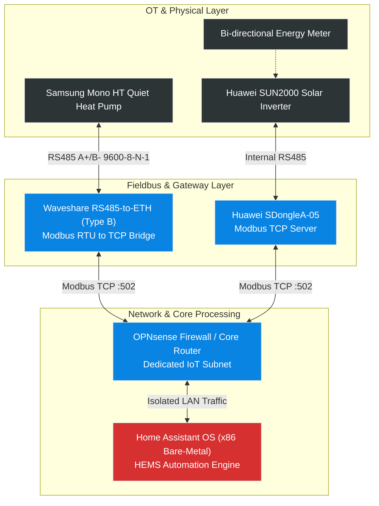

# Production Edge IoT & Home Energy Management System (HEMS)


A production-grade, 24/7 high-availability Home Energy Management System (HEMS) deployed on bare-metal x86 architecture using **Home Assistant OS (HAOS)**.

This repository documents the physical integration, network design, OT/IT bridging, and real-time algorithmic cost arbitrage coordinating a heat pump with rooftop solar photovoltaics under multi-zone distribution tariffs.

---

## 🏛 System Architecture & Data Flow

The infrastructure is strictly **Local-First**, ensuring zero operational dependency on external vendor cloud services. Data acquisition and control loops operate purely across dedicated local subnets via industrial serial and Ethernet protocols.



---

## ⚙ Hardware & Protocol Specifications

| Device | Role / Domain | Physical Interface | Protocol / Profile | Parameters |
| :--- | :--- | :--- | :--- | :--- |
| **x86 Host (Repurposed)** | Core HAOS Compute | Realtek Gigabit NIC | Native OS / Docker Host | 24/7 Low Power x86 Host |
| **Samsung Mono HT Quiet** | Primary HVAC / DHW | RS485 Terminals | Modbus RTU | 9600 Baud, 8 Data Bits, None, 1 Stop Bit |
| **Waveshare Type B** | Industrial Media Converter | RS485 to RJ45 ETH | Modbus RTU over TCP | Static IP, Buffer Timeout 10ms |
| **Huawei SUN2000 + SDongle**| PV Inverter & Grid Telemetry | Fast Ethernet (RJ45) | Modbus TCP | Port 502, Unit ID 1, Firmware SPC133+ |
| **Tauron AMI Grid Meter** | Grid Reference | Wireless Mesh | G12w Multi-Zone Tariff | Peak: 06-13, 15-22 / Off-Peak: 13-15, 22-06, Wknd |

---

## 🧠 Business Logic: Tariff & PV Arbitrage

The core automation (`automations/heat_pump_photovoltaic_optimizer.yaml`) executes deterministic cost optimization:

1. **Photovoltaic Self-Consumption (Priority 1):**
   * Dynamically tracks inverter active generation.
   * Surplus > **2000W** triggers heat pump over-heating (DHW to 50°C, Water Law offset -0.5).
2. **Optimal Daytime COP Window (13:00 – 15:00):**
   * Matches peak outdoor temperatures with low-cost G12w window.
3. **Off-Peak Night & Weekend Storage:**
   * Utilizes baseline tariff rates to sustain structural thermal mass.
4. **Peak Shaving:**
   * Throttles output during expensive T1 hours, leveraging building inertia.

---

## 🛠 Engineering Challenges & Troubleshooting

### 1. Huawei SDongleA-05 Modbus TCP Firmware Bottleneck
* **Symptom:** Port 502 connection rejected.
* **Root Cause:** Factory SPC109 firmware restricted local access.
* **Resolution:** Escalated to Huawei Tier-2 Engineering for SPC133 upgrade, unlocking local polling.

### 2. RS485 Serial Timing on Waveshare Gateway
* **Symptom:** Intermittent Modbus command drops.
* **Resolution:** Implemented 2s inter-frame delay between register writes to prevent half-duplex buffer saturation.

---

## 🗺 Future Roadmap (Next Steps)

Planned expansions to enhance system granularity and security:

*   **Secure Visual Monitoring:** 
    *   Integration of **TP-Link IP Cameras** via RTSP/ONVIF protocols. 
    *   Implementation of strict **VLAN isolation** on OPNsense to ensure cameras remain air-gapped from the Internet while providing local H.264 streams to Home Assistant.
*   **Multi-Zone Thermal Feedback:** 
    *   Deployment of high-precision temperature sensors on both **Ground Floor** and **First Floor**.
*   **Advanced Control Loop Logic:** 
    *   Refining the Heat Pump optimization engine to move from a "Weather Compensation only" model to a **Hybrid Thermal Feedback loop**.
    *   The system will use real-time indoor temperature deltas to adjust the Modbus Water Law offsets more accurately.

---

## 🔒 Security & Local-First Philosophy

* **Secrets Decoupling:** Credentials abstracted into `secrets.yaml`.
* **Network Segmentation:** Physical separation via OPNsense VLANs for IoT devices.
* **CI Validation:** Automatic YAML linting via GitHub Actions.

---

## 🚀 Repository Structure

```text
├── .github/
│   └── workflows/
│       └── lint.yml          # GitHub Actions Yamllint CI pipeline
├── automations/
│   └── heat_pump_photovoltaic_optimizer.yaml  # Production arbitrage engine
├── .gitignore                # Comprehensive HAOS gitignore
├── README.md                 # Production architecture documentation
└── secrets.yaml.example      # Sanitized configuration blueprint
```