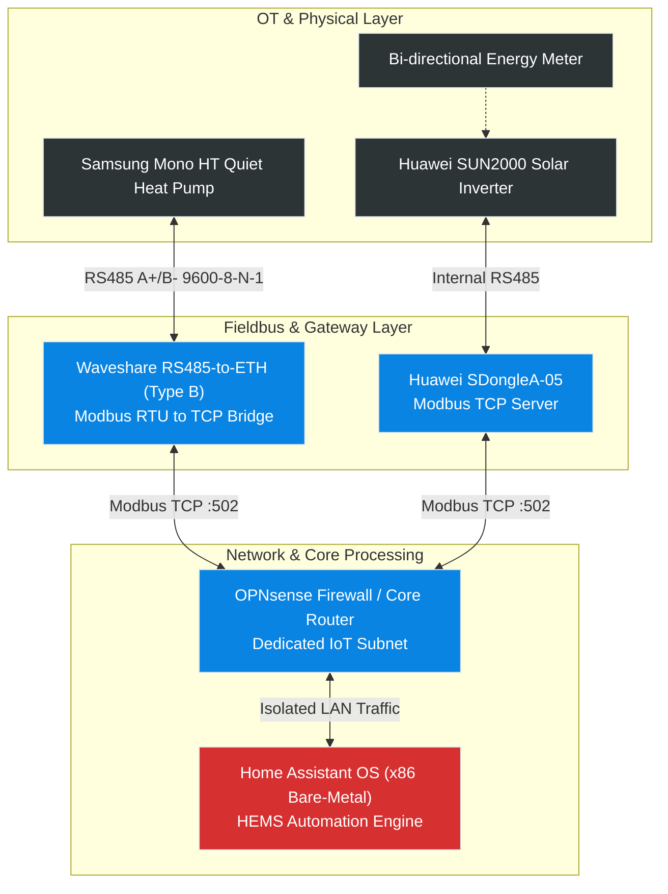

# Production Edge IoT & Home Energy Management System (HEMS)


A production-grade, 24/7 high-availability Home Energy Management System (HEMS) deployed on bare-metal x86 architecture using **Home Assistant OS (HAOS)**.

This repository documents the physical integration, network design, OT/IT bridging, and real-time algorithmic cost arbitrage coordinating a heat pump with rooftop solar photovoltaics under multi-zone distribution tariffs.

---

## 🏛 System Architecture & Data Flow

The infrastructure is strictly **Local-First**, ensuring zero operational dependency on external vendor cloud services. Data acquisition and control loops operate purely across dedicated local subnets via industrial serial and Ethernet protocols.



---

## ⚙ Hardware & Protocol Specifications

| Device | Role / Domain | Physical Interface | Protocol / Profile | Parameters |
| :--- | :--- | :--- | :--- | :--- |
| **x86 Host (Repurposed)** | Core HAOS Compute | Realtek Gigabit NIC | Native OS / Docker Host | 24/7 Low Power x86 Host |
| **Samsung Mono HT Quiet** | Primary HVAC / DHW | RS485 Terminals | Modbus RTU | 9600 Baud, 8 Data Bits, None, 1 Stop Bit |
| **Waveshare Type B** | Industrial Media Converter | RS485 to RJ45 ETH | Modbus RTU over TCP | Static IP, Buffer Timeout 10ms |
| **Huawei SUN2000 + SDongle**| PV Inverter & Grid Telemetry | Fast Ethernet (RJ45) | Modbus TCP | Port 502, Unit ID 1, Firmware SPC133+ |
| **Tauron AMI Grid Meter** | Grid Reference | Wireless Mesh | G12w Multi-Zone Tariff | Peak: 06-13, 15-22 / Off-Peak: 13-15, 22-06, Wknd |

---

## 🧠 Business Logic: Tariff & PV Arbitrage

The core automation (`automations/heat_pump_photovoltaic_optimizer.yaml`) executes deterministic cost optimization:

1. **Photovoltaic Self-Consumption (Priority 1):**
   * Dynamically tracks inverter active generation (`sensor.piwnica_inwerter_moc_czynna`).
   * When surplus exceeds **2000W** (stabilized for 3 minutes), the system aggressively shifts the heat pump's weather compensation curve offset (`intempwaterlawtargetf`) to `-0.5` and raises the Domestic Hot Water (DHW) storage setpoint to `50°C`.
   * Hysteresis (`below: 1900W` for 2 minutes) prevents compressor short-cycling during transient cloud cover.

2. **Optimal Daytime COP Window (13:00 – 15:00):**
   * Matches peak outdoor ambient temperatures (maximizing thermodynamic coefficient of performance) with the Tauron G12w cheap afternoon energy window.

3. **Off-Peak Night & Weekend Thermal Storage (22:00 – 06:00 / Sat–Sun):**
   * Uses low-cost baseline grid energy to sustain structural thermal mass and DHW without entering expensive daytime tariff bands.

4. **Peak Shaving (Default / On-Peak Hours):**
   * Drops the target water law offset down to `-5.0` and DHW setpoint to `40°C`, relying entirely on the building's thermal inertia to glide through high-tariff spikes without comfort degradation.

---

## 🛠 Engineering Challenges & Troubleshooting

### 1. The Huawei SDongleA-05 Modbus TCP Firmware Bottleneck
* **Symptom:** Inability to maintain Modbus TCP connection on port 502; socket immediately terminated by inverter gateway.
* **Root Cause Analysis:** Factory shipping firmware version `V100R001C00SPC109` restricted local Modbus TCP access, enforcing strict cloud-only communications via FusionSolar.
* **Resolution:** Escalated technical inquiry through Huawei Solar Tier-2 Engineering support. Obtained and deployed remote firmware upgrade package (`V100R001C00SPC133` / `SPC140`), successfully unlocking unrestricted local-network Modbus TCP polling.

### 2. RS485 Serial Timing & Register Chattering on Waveshare Gateway
* **Symptom:** Intermittent Modbus command drops when updating multiple registers simultaneously (e.g., Water Law target and DHW target).
* **Root Cause Analysis:** The Waveshare RS485-to-Ethernet bridge experienced buffer saturation when consecutive TCP frame packets were translated to half-duplex RS485 serial transmissions without an inter-frame delay.
* **Resolution:** Implemented explicit 2-second bus settling intervals (`delay: "00:00:02"`) inside Home Assistant sequences between sequential `number.set_value` register writes, ensuring zero serial frame dropouts.

---

## 🔒 Security & Local-First Philosophy

* **Secrets Decoupling:** Sensitive credentials, unit identifiers, and IP allocations are abstracted into `secrets.yaml` (see [`secrets.yaml.example`](secrets.yaml.example)).
* **Network Segmentation:** Physical separation planned on OPNsense, restricting all IoT/Modbus devices to an isolated VLAN with no outbound WAN traversal permission.
* **CI Validation:** Every commit undergoes automatic syntax and structural validation via GitHub Actions ([`.github/workflows/lint.yml`](.github/workflows/lint.yml)).

---

## 🚀 Repository Structure

```text
├── .github/
│   └── workflows/
│       └── lint.yml          # GitHub Actions Yamllint CI pipeline
├── automations/
│   └── heat_pump_photovoltaic_optimizer.yaml  # Production arbitrage engine
├── .gitignore                # Comprehensive HAOS gitignore
├── README.md                 # Production architecture documentation
└── secrets.yaml.example      # Sanitized configuration blueprint
```